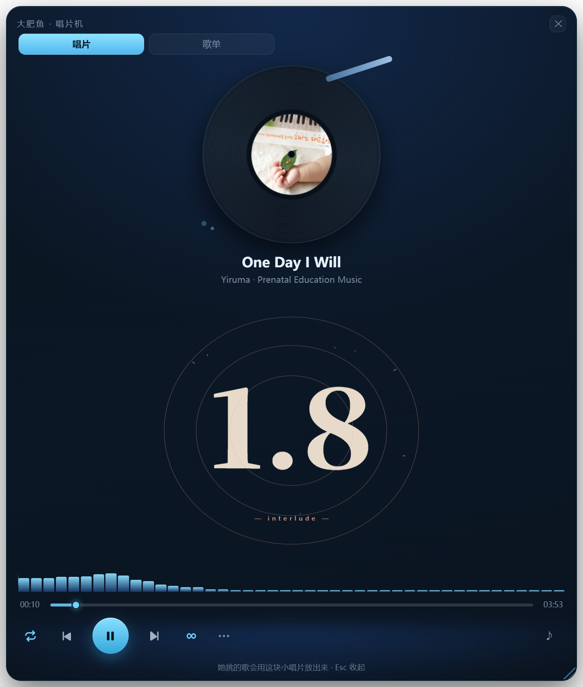
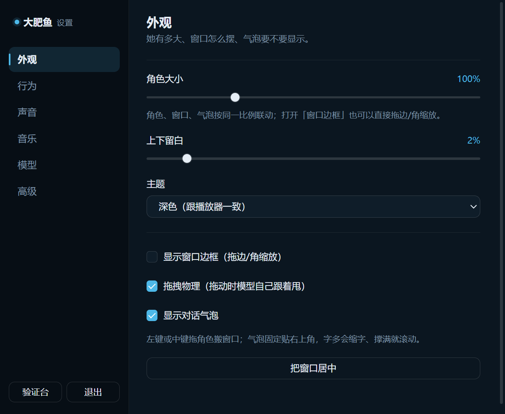

# 大肥鱼桌宠（dafeiyu-desktop-pet）

一个跑在 Windows 桌面上的 Live2D 桌宠：**身体**是 Live2D 模型 + 物理 + 表情/动作层，
**大脑**接 [AstrBot](https://github.com/AstrBotDevs/AstrBot) 的人格与记忆，
**嘴**是本地 TTS（Qwen3-TTS 克隆 + 情绪母带），**耳朵**是本地 ASR（SenseVoice）。

> 角色 **大肥鱼（DeepSeek-chan）** 的皮套由 **神宫凉子**（原画及拆分）与 **霓虹猫_NeonNeko**（Live2D 建模）制作，
> 按作者的使用须知免费配布。本项目只做「外壳」，**不随仓库分发模型文件**——来源、署名与原因见 [CREDITS.md](CREDITS.md)。






## 特性

- **桌面存在感**：透明无边框窗口、按轮廓的鼠标穿透（点到角色才算点中）、拖动 / 滚轮缩放 / 吸附
- **会动**：呼吸、眨眼、视线跟随鼠标、被拖动时物理甩动、空闲随机小动作
- **会互动**：点她、摸头、摸尾巴位置不同反应不同；离开久了「惦记」，回来打招呼
- **会说话**：接 AstrBot 流式对话（以 `complete` 全文为准再逐字吐）；没配大脑时回落本地台词
- **有表情和动作**：语义标记 `[[act:…]]` `[[face:…]]` `[[wear:…]]` `[[play:…]]`，她自己决定演什么
- **心情系统**：七轴（开心/不爽/困/惦记/黏人/无聊/害羞）决定气泡边框颜色与标签
- **装扮**：9 个槽位（眼镜/裙子/鞋/尾巴/形态/大小/配件/牙/上半身），点一下立即生效并记住
- **唱片机**：网易云搜索、歌单、队列、扫码登录、漫游续播、24 套歌词 PV 样式
- **本地语音**：四情绪母带 TTS + SenseVoice 语音转文字，长按说话
- **工作联动**：接 DSH 插件状态，她跟着「在想 / 在做 / 等你确认 / 收工 / 出错」做反应
- **对话记录**：本地 jsonl，可导出、可清空

## 系统要求

| 项 | 要求 |
|---|---|
| 系统 | Windows 10 / 11 x64 |
| Node | **20 或更高**（只开发需要；打包后的 exe 不需要 Node） |
| 显卡 | 集显也能跑；要用本地 TTS 建议有 NVIDIA 显卡（6 GB 以上显存） |
| 磁盘 | 仓库约 40 MB；模型自备；TTS 模型约 1.5 GB |

## 下载

不装 Node 也能用：[Releases](https://github.com/linyuyun-a/dafeiyu-desktop-pet/releases) 里有 Windows x64 压缩包（约 350 MB，自带 Electron 与 Cubism Core，**不含皮套**）。

解压到**短路径**（例如 `D:dafeiyu`）再双击 —— exe 完整路径超过约 65 个字符时 Windows 下会静默退出。首次运行会让你选模型。

## 快速开始

```bash
git clone https://github.com/linyuyun-a/dafeiyu-desktop-pet.git
cd dafeiyu-desktop-pet
npm install            # 依赖（会自动打两个引擎补丁，见 scripts/patch-*.mjs）
npm run core           # 下载 Live2D Cubism Core（专有许可，不随仓库分发）
```

**放模型**：把自己的 Live2D 模型放进 `assets/model/`（里面要有 `model3.json`），或者启动时用参数指过去：

```bash
npm run app -- --model "D:/某处/她的模型.model3.json"
```

也可以用导入脚本（递归找 `model3.json`，会过滤掉图片/压缩包）：

```bash
npm run model:import -- "D:/下载/她的模型目录"
```

然后启动：`npm run app`。首次启动会自动找 `assets/model/model3.json`，找不到会弹窗让你选。

**模型需要自备**：本仓库不含任何 Live2D 模型。作者的使用须知允许个人创作与二次创作，但
**不允许重新分发完整模型文件**，所以这里只给接入方式，不给文件——请到作者发布页获取。

## 数据放在哪

| 内容 | 位置 |
|---|---|
| 设置、对话记录、装扮、心情 | `%APPDATA%\大肥鱼Live2d桌宠\` |
| 大脑地址与 Key | 仓库根目录 `brain.config.json`（已在 `.gitignore` 里） |
| TTS 母带 | `app/tts/voices/`（自备，见下） |
| ASR 模型 | `%APPDATA%\大肥鱼Live2d桌宠\asr\`（自备，见下） |

## 接大脑（AstrBot）

不接也能跑：**不填 Key 会自动回落到 mock**（本地固定台词），气泡照常出现，只是不会真聊天。

1. 在跑 AstrBot 的机器上打开 `WebUI → 设置 → OpenAPI`，新建 API Key，权限至少勾 `chat`。
2. 复制 `brain.config.example.json` 为 `brain.config.json`：

```json
{
  "brain": "astrbot",
  "astrbotUrl": "http://你的服务器:6185",
  "astrbotKey": "abk_xxxxxxxx",
  "astrbotConfig": "桌宠版"
}
```

3. 启动桌宠。它调 `/api/v1/chat`，`username` 固定 `desktop_pet`，
   `session_id` 存在 `_data/stage-chat-state.json`——**那就是她的「记忆槽」，换掉等于失忆**。
4. 想让人设生效：在 AstrBot 里**用 WebUI 的「复制配置文件」**复制一份（不要用 API 建，
   会丢 `admins_id` 导致 chat 不响应），把人设写进去，再填进 `astrbotConfig`。

也可以用环境变量覆盖：`ASTRBOT_URL` / `ASTRBOT_API_KEY` / `PET_BRAIN`。

## 声音（TTS，需要自备）

语音合成用四条**情绪母带**（soft / angry / sleepy / happy）做参考音克隆。母带是从人声克隆出来的，
**涉及原声权利，不随仓库分发**。没有它们时桌宠照样能打字对话，只是不出声。

1. 建一个 Python venv（3.11 或 3.12）：

```bash
python -m venv .venv
.venv\Scripts\pip install faster-qwen3-tts sherpa-onnx soxr numpy
```

2. 下 Qwen3-TTS 0.6B 权重，放到 `app/tts/models/qwen3tts-0.6B/`，
   或用环境变量指定：`PET_TTS_MODEL=D:\models\qwen3tts-0.6B`。

3. 用 `faster_qwen3_tts` 的 `generate_voice_clone(text, ref_audio=…, ref_text=…, xvec_only=False)`，
   拿同一段 3–10 秒参考音、换四种语气提示词各生成一条 → 放进 `app/tts/voices/`，
   文件名是 `soft.wav / angry.wav / sleepy.wav / happy.wav`，同名 `.txt` 写参考音原文，
   再写一个 `index.json` 指定 `default`。

4. 启动桌宠，它会在 `127.0.0.1:8769` 起服务（设置页「声音」能看状态，冷启动 40–90 秒）。
   没有 GPU 或不想跑：设置里关掉「让她出声」即可。

## 耳朵（ASR，可选）

默认 SenseVoice（CPU，15 秒音频约 0.7 秒）：

1. 从 [sherpa-onnx releases](https://github.com/k2-fsa/sherpa-onnx/releases) 下 `sherpa-onnx-sense-voice-*` 模型包；
2. 把 `model.int8.onnx` 与 `tokens.txt` 放进 `%APPDATA%\大肥鱼Live2d桌宠\asr\sensevoice\`；
3. 设置页「声音 → 语音转文字」选 SenseVoice。

想更准可以换 Qwen3-ASR（吃显存），模型目录用 `PET_QWEN_ASR_DIR` 指定。

## 开发

```bash
npm run app          # 开发运行（Electron 直接跑 app/main.mjs）
npm run pack         # 打包成 exe（默认不带模型）
STAGE_MODEL_SRC="D:/模型/大肥鱼" npm run pack   # 把模型一起打进去
npm run core         # 单独补 Live2D Core
npm run model:import -- "<目录>"               # 导入模型
```

代码结构：

```
app/                 Electron 主进程 + 渲染层（无打包器，直接 ESM）
  main.mjs           窗口、IPC、TTS/ASR 拉起、音乐服务
  renderer.js        舞台接线：情绪、气泡、装扮、触发器
  player.*           唱片机独立窗口
  settings.*         设置窗口
  brain/             大脑适配器（astrbot / mock）
  tts/               本地 TTS + ASR（Python）
  fx/, jizura-engine.js   歌词 PV 与动效层
src/stage/           Live2D 舞台：engine / layers / regions / bubble / mood …
scripts/             构建、打包、导入、引擎补丁
```

## 常见问题

**双击 exe 没反应**——先看安装路径长度。整条 exe 全路径超过约 65 字符时，Electron 带沙箱启动会静默退出；
把整个文件夹挪到 `D:\大肥鱼桌宠\` 这种短路径再试。

**窗口在、人不见了**——上次崩溃后进了「安全模式」（关掉 GPU 合成，Live2D 落到软渲染）。
删掉 `%APPDATA%\大肥鱼Live2d桌宠\boot.json` 再启动。

**她说不出话**——看设置页「声音」状态，显示 `就绪` 才是好的。冷启动要 40–90 秒；日志在 `_data/tts.log`。

**点歌没反应**——唱片机需要登录网易云（设置 → 音乐 → 扫码登录）。会员歌未登录只能播 45 秒试听。

**`-460 检测到您的网络环境存在风险`**——网易云的接口级风控，不是封号，等两分钟再操作。

## 许可

代码以 **MIT** 发布，见 [LICENSE](LICENSE)。
第三方组件，以及明确不随仓库分发的内容（Live2D Core / 模型），见 [THIRD-PARTY.md](THIRD-PARTY.md)；
角色与皮套的署名、来源与使用限制见 [CREDITS.md](CREDITS.md)。

## 声明

- 本项目与 Live2D Inc.、网易云音乐、AstrBot 官方均无隶属关系。
- 音乐与歌词在运行时通过**用户自己的账号**获取，仅供个人使用；请勿用于再分发。
- 仓库里不含任何模型文件、语音母带和 API Key。
